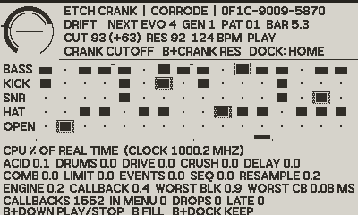

# ETCH CRANK

**A generative acid machine for Playdate — by Synth Centric**

ETCH CRANK is the fifth ETCH, after ETCH (Game Boy), ETCH II (GBA), ETCH DS and ETCH 3DS. **The crank is the 303's filter cutoff:** turn it clockwise to open the filter and back to close it. Everything else is ETCH: the same composer (CORROSION, byte for byte), the same seed codes, the same living songs, and ETCH DS's sound, sample for sample.

This is **milestone 1, "It squelches under the crank"**. It proves the crank and the sound before the interface is built.



* **Launch it, hear music.** It boots straight into ETCH's demo song CORRODE, composed by CORROSION from its seed code `0F1C-9009-5870`, living in DRIFT. The crank is never needed for sound.
* **The crank:**
  * Cutoff, relative, with 540° from closed to open and hard stops at both ends. The steps are linear in pitch, so equal turns are equal intervals.
  * The audio glides to it, and the filter moves on every sample.
  * **B + crank** is resonance.
  * **Dock** the crank: the filter glides home to its stored values over one beat. **B + dock** keeps where you are.
* **ETCH DS's engine, unmodified:** ACID (SAW / SQUARE / HOLLOW / BITE, resonant ladder, accent, slide, drive), FOUNDRY's six drum lanes and the FX chain. ETCH's clock and step rules run with ETCH II's fixes, sample-accurate inside the audio callback.
* **The status band:** the cutoff arc around a scope, the mode, the bars until the next evolution, the generation and the song position. Below it, the pattern (evolved steps fade through dither), and a per-stage CPU meter.

The milestone report is [`docs/MILESTONE1_REPORT.md`](docs/MILESTONE1_REPORT.md). The design is in [`docs/ARCHITECTURE.md`](docs/ARCHITECTURE.md), the button map in [`docs/CONTROLS.md`](docs/CONTROLS.md), and parked ideas in [`docs/IDEAS.md`](docs/IDEAS.md).

## Controls (milestone 1)

| | |
|---|---|
| crank | filter cutoff |
| B + crank | resonance |
| dock the crank | cutoff and resonance glide home over one beat |
| B + dock | keep the live cutoff and resonance |
| B + DOWN | play / stop |
| B (tap) | FILL on / off |
| Menu → `cpu test` | ETCH DS's CPU test, for reading the meter on hardware (temporary) |

Held B stands in for ETCH's SELECT. The full map, including later milestones, is in `docs/CONTROLS.md`.

## Building

You need the Playdate SDK (tested with 3.1.2, with `PLAYDATE_SDK_PATH` set) and `arm-none-eabi-gcc` (tested with 13.2.1).

```bash
make
```

That checks that `corrosion/` and `engine/` still match their checksums, then builds `ETCH_CRANK.pdx` for the device and the Simulator. A prebuilt `release/ETCH_CRANK.pdx.zip` is included for sideloading.

## Testing

```bash
make test DS=/path/to/ETCH-DS
```

* ETCH's 44 CORROSION tests and ETCH DS's sequencer and sound tests, all unmodified, against the copies here.
* The **sound consistency test**: 16 bars of CORRODE through ETCH DS (built from that checkout) and through this port. They are bit-identical.
* The crank and the resampler.
* It writes `build/host/crank_sweep.wav` to listen to.

```bash
make arm-test
```

The consistency test again, built for the Cortex-M7 with the SDK's device flags and run under `qemu-arm`.

```bash
python3 tools/arm_cost.py
```

Instructions per stage on the Cortex-M7 build (a qemu trace).

```bash
python3 tools/sim_drive.py
```

Drives the Playdate Simulator headless. It needs Xvfb, PulseAudio and xdotool.

```bash
tools/verify_corrosion.sh /path/to/Etch---GB /path/to/ETCH-DS
```

Proves CORROSION byte for byte against ETCH and ETCH DS.

## Layout

```
corrosion/   CORROSION from ETCH, byte-identical (checksummed)
engine/      ETCH DS's sequencer and sound engine, unmodified (checksummed)
platform/    the Playdate layer: audio pump + resampler, crank, screen, boot
tests/       host tests
tools/       sync, verify, parity, cost, resampler table, Simulator driver
docs/        architecture, controls, milestone report, ideas
```

## Credits

**ETCH CRANK — by Synth Centric, for Playdate.** Synth Centric is Dan Schwebel. CORROSION comes from ETCH (MIT; see `corrosion/LICENSE.ETCH`), the sound engine from ETCH DS, and the swing-change fix and edit epoch from ETCH II. Built with the Playdate SDK. Playdate is a trademark of Panic Inc.; ETCH CRANK is not affiliated with or endorsed by Panic. TB-303 is a trademark of Roland Corporation; ETCH CRANK is not affiliated with Roland.
