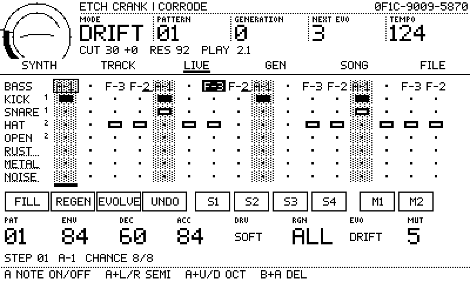
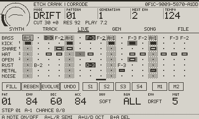
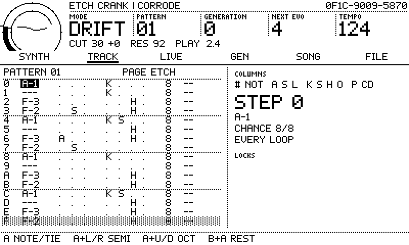
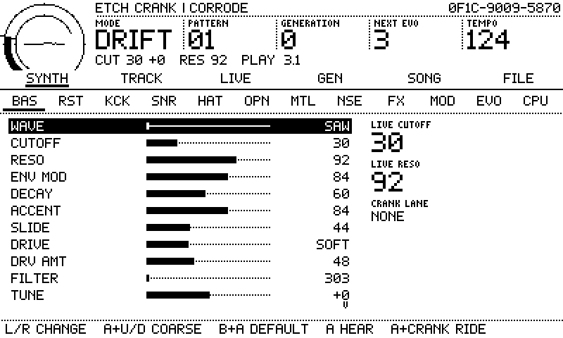
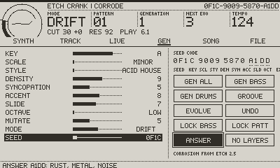

# ETCH CRANK — manual

### A generative acid machine by Synth Centric, for Playdate



## 1. What it is

ETCH CRANK is the fifth ETCH, after ETCH (Game Boy), ETCH II (GBA), ETCH DS and ETCH 3DS:

* Its composer, **CORROSION**, writes an acid bassline and a drum groove, then keeps rewriting them while they play.
* An acid bass voice, synthesised drums and an effects chain play it: the same engine as ETCH DS, sample for sample.
* **The crank is the filter.**

A **seed code** such as `0F1C-9009-5870` always makes the same groove, on every ETCH.

## 2. Quick start

1. **Launch it.** ETCH's demo song CORRODE plays at once, composed from its code and living in DRIFT: every four bars, everything changes a little.
2. **Take the crank out and turn it.** Clockwise opens the filter, back closes it. Hold **B** while turning for resonance.
3. **Dock the crank.** The filter glides home in one beat. Hold **B** while docking to keep where you are instead.
4. **B + DOWN** stops and starts.
5. **B + LEFT / RIGHT** moves along the screens. **LIVE** is home.

## 3. The screen

The **status band** across the top is always there:

* the **cutoff arc** around a scope: the filled arc is the live cutoff, the tick is the stored value, and the inner arc is resonance
* the song and its seed code
* **MODE · PATTERN · GENERATION · NEXT EVO · TEMPO**
* the live cutoff and resonance, play state, position, and FILL / REC / SPK when they're on
* the **screen row**:

```
 SYNTH  <-  TRACK  <-  LIVE  ->  GEN  ->  SONG  ->  FILE
```

The bottom line always says what the buttons do where the cursor is.

## 4. The grammar

The same buttons do the same kinds of things everywhere, as on every ETCH:

| | |
|---|---|
| D-pad | move |
| A | place / toggle / do |
| A held + LEFT / RIGHT | value −1 / +1 (a semitone on a note) |
| A held + UP / DOWN | value coarse (an octave on a note) |
| B + A | delete / back to default |
| **held B** | ETCH's SELECT: **B + LEFT / RIGHT** screens, **B + DOWN** play / stop, **B + UP** crank recording |
| B tap | LIVE: FILL on / off; elsewhere: back |
| A held + crank | rides the value under the cursor |

The full map is in [CONTROLS.md](CONTROLS.md).

## 5. The crank

* **Cutoff.** The crank is relative, so picking it up never jumps the filter. 540° takes the filter from fully closed to fully open; past either end it stops, and turning back moves at once. Equal turns are equal musical intervals: 4¼° is two-thirds of a semitone, and a quarter turn about 14 semitones.
* **Stored value and live offset.** The pattern keeps its stored cutoff and resonance, as on ETCH. The crank plays an offset on top. ETCH's living song may drift the stored sound, never your offset.
* **Docking** glides home over one beat. **B + dock** makes the live values the new stored values.
* **Recording (B + UP).** From the next bar line, one bar of crank movement is written into the pattern's **crank lane**, which then plays back every bar, with "LANE" under the arc. Cranking further rides on top. In CORRODE the lane itself evolves: it shifts, thins and re-times, always bounded by what you recorded. SYNTH → BAS → CRANK LANE clears it.
* **Riding values.** Hold A on any value (a SYNTH knob, a GEN setting, BPM, a LIVE macro) and turn.
* **Morphing scenes.** Hold A on a scene pad and turn: half a turn morphs all the way.

## 6. LIVE



* **The grid:**
  * BASS and the four drum lanes are CORROSION's.
  * RUST, METAL and NOISE are the **layers** (§9).
  * Steps CORROSION has just changed start solid and fade through dither over two bars.
* **Editing:** A on an empty bass step writes the last note; A on a note removes it; A + D-pad moves it. A on a drum step toggles the hit.
* **Lane names:** A mutes the lane; A + LEFT / RIGHT puts it in mute group 1 or 2.
* **Pads:**
  * **FILL** plays a fill.
  * **REGEN** rewrites exactly half the bar.
  * **EVOLVE** evolves at the next bar; **UNDO** takes back the last generation.
  * **S1–S4** are scenes: A on an empty one stores the sound, A recalls it, A + crank morphs towards it, B + A clears it.
  * **M1 M2** mute or unmute a group.
* **Macros:** PAT (queue a pattern), ENV, DEC, ACC, DRV, RGN (what REGEN rewrites), EVO (the mode), MUT (how much evolution changes).

## 7. TRACK



ETCH's tracker, one row per 16th: `# NOT A S L K S H O P CD`.

* **NOT** is the note (A on a note makes a tie); **A S L** are accent, slide and step lock; **K S H O** are the drums.
* **P** is the chance (1–8 out of 8), rolled live.
* **CD** is the condition: 1st or 2nd of every 2 loops, 1st–4th of every 4, only in fills, never in fills.

The header's **PAGE** switches to the **LAYERS** page: RUST's note, chord, accent and tie; METAL and NOISE; and ratchets (1–4 hits) for each drum lane.

## 8. SYNTH



| Tab | What it is |
|---|---|
| BAS | ACID, ETCH DS's 303: WAVE (SAW, SQUARE, HOLLOW, BITE), CUTOFF, RESO, ENV MOD, DECAY, ACCENT, SLIDE, DRIVE (OFF, SOFT, HARD, FOLD), DRV AMT, FILTER (303 or KEY tracking), TUNE, LEVEL, GATE, the crank lane |
| RST | RUST: OSC A, OSC B, INTERVAL, DETUNE, SYNC, RING, CUTOFF, RESO, ENV MOD, DECAY, MODE (MONO or PARA 3), GATE, LEVEL, the layer lengths and lock |
| KCK SNR HAT OPN MTL NSE | FOUNDRY's drum designer (ETCH DS's DRUM page): KIT, MODEL, PITCH, PITCH END, SWEEP, DECAY, NOISE, DRIVE, TUNE, LEVEL, MUTE, LOCK. A sound is re-synthesised as you edit it, while the song plays |
| FX | DRIVE, CRUSH, HOLD, DELAY (in 16ths; the repeats degrade), FEEDBACK, MIX, ROT, COMB NOTE, FB, MIX, LIMIT |
| MOD | four routings, each a source (CRANK, TILT, LFO, ENV, MIC), a destination and a depth; the LFO's rate and shape |
| EVO | sound evolution: ON / OFF, and a lock per knob |
| CPU | the per-stage CPU meter and the CPU TEST |

## 9. GEN and the layers



**GEN** holds CORROSION's settings:

* KEY, SCALE, STYLE, DENSITY, SYNCOPATION, ACCENT, SLIDE, OCTAVE
* MUTATE, MODE (STABLE never changes; DRIFT makes small changes every 4 bars around the pattern's memory; CORRODE makes bigger ones every 2)
* SEED: A gives a new seed and GEN ALL

The **seed code** is 12 digits, the same on every ETCH, plus an optional **4th group**. Edit a digit with A + UP / DOWN; A loads the code.

**The layers** are three extra parts: **RUST** (a second synth voice), **METAL** and **NOISE**. They *answer* what CORROSION wrote:

* RUST calls back where the bass rests.
* METAL fills the gaps in the hats.
* NOISE pushes into the bar line.
* Hat rolls are ratchets.

They play when the code has a 4th group. **ANSWER** picks a new one and the layers answer every pattern; **NO LAYERS** removes it, and the song is exactly ETCH DS's again. Writing a layer step by hand also turns them on, and locks that pattern's layers.

The other actions are ETCH's: GEN ALL, GEN BASS, GEN DRUMS, GROOVE (the style's drum groove), EVOLVE, UNDO, LOCK BASS, LOCK PATT.

## 10. SONG

* SONG MODE, BPM and SWING
* ETCH's 16-slot chain: each slot is a pattern played for 1–8 bars, or END
* COPY the playing pattern to another; CLEAR it (UNDO brings it back)

## 11. FILE

* **NEW**: an empty project.
* **LOAD**: ETCH's eight demo songs (CORRODE, SLAG, 303HZ, CAUSTIC, RUSTROT, VOLTAGE, HEXDRUM, ACIDBURN), the boot song, and your 16 saves.
* **SAVE**: 16 slots.
* **CODE**: start from a seed code.
* **IMPORT DS** and **IMPORT GB**: ETCH DS saves (copy `etch_ds.sav` into the game's data folder) and ETCH Game Boy saves (`etch_gb.sav`).
* **ABOUT**.

Saves go to the game's data folder in ETCH DS's own format, with ETCH's checksum-first, header-last order, so an interrupted save never looks valid.

## 12. The system menu

* **speaker**: AUTO, ON or OFF. On the speaker the mix goes mono with a gentle low-mid lift; AUTO switches it with the headphones.
* **tilt**: tilting the Playdate rides the delay send.
* **crank bite**: with the crank out, how far the filter is open sets how much CORROSION changes.

## 13. Tips

* Leave the crank docked and the song still sounds finished. The crank is for when you want to play.
* Record a crank lane in CORRODE and let the machine bend your gesture.
* Lock BASS on GEN to keep a bassline while the drums keep evolving.
* Share the code, all 16 digits, to share the whole song.

---

ETCH CRANK — by Synth Centric. Code and CORROSION: MIT licence. Sound engine from ETCH DS. Every sound is synthesised. Built with the Playdate SDK; Playdate is a trademark of Panic Inc., and ETCH CRANK is not affiliated with Panic. TB-303 is a trademark of Roland Corporation.
